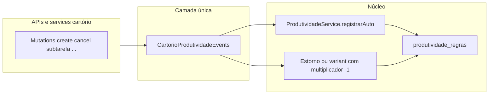

# Plano consolidado — produtividade automática (cartório interno)

Documento único: **arquitetura**, **inventário**, **fases**, **decisões de produto** (questionários blocos 1–4) e **governação** do próprio plano.

### Governação (alinhamento repo × artefato Cursor)

| Tema | Convenção |
|------|-----------|
| **Fonte de verdade** | Apenas ficheiros **versionados no Git** neste repositório. O ficheiro `*.plan.md` em `%USERPROFILE%\.cursor\plans\` é **opcional**; alinhar ao plano do repo **manualmente** quando quiseres o painel do Cursor consistente. |
| **Progresso** | Checklists **neste MD** (secção 9). Ao **fechar uma fase** (1–5), registar entrega em **`docs/90-releases/notes/`** (nota de release do ciclo), com referência a este plano e ao catálogo quando existir. |
| **Spec do módulo** | O módulo interno de produtividade documenta-se em **[modulo-produtividade-interna.md](../../docs/20-modules/specs/modulo-produtividade-interna.md)**; inclui secção **Cartório — eventos automáticos** com ligação a este ficheiro. |

O ficheiro [cartorio-produtividade-decisoes.md](cartorio-produtividade-decisoes.md) mantém-se só como **redirecionamento** para não partir links antigos; o conteúdo decisório está **aqui** (secção 2 e tensões na secção 8).

---

## 1. Objetivo

Automatizar lançamentos em `produtividade_lancamentos` para **mutações relevantes** do cartório (criação, conclusão de subtarefa, cancelamento/delete quando aplicável, etc.), com **catálogo canônico** de movimentos, regras em `produtividade_regras`, **penalidades espelhadas** quando couber, e **sem backfill** histórico.

---

## 2. Decisões de produto (congeladas para implementação)

| Área | Decisão |
|------|---------|
| **Disparo** | Catálogo fechado de **mutações**; **não** pontuar `update` genérico nem leituras (`list`, `buscar-cidade`, …) salvo inclusão explícita futura. |
| **Titular** | Sempre **usuário da sessão** que executou a ação. |
| **Penalidade — valor** | **Espelho** do lançamento positivo pareado (mesma magnitude, invertida). |
| **Penalidade — quando** | **Só se já existiu** lançamento automático **positivo** associado à entidade/subtarefa (cancel/delete conforme catálogo). |
| **Desalocar** | **Nunca** penaliza; **sem** evento de produtividade para desalocar (excluir do catálogo ou no-op documentado). |
| **Técnica negativos** | Preferir **regra com `pontos_multiplicador` −1** (ou regra espelho dedicada) **sem** mudança de schema obrigatória. |
| **Idempotência penalidade** | **Um** débito por **(entidade + tipo_evento_cancel)** via **`contexto_hash`** específico. |
| **Guias** | **Substituir** `registrarAuto` “fixo” em [`Guias.php`](../app/services/Guias.php) por **`event_code`** do catálogo via helper; alinhar com `cartorio-guias/create` para **zero duplicidade**. |
| **Nomenclatura UI** | **Verbo + objeto**; incluir **número do processo** no texto automático quando existir. |
| **Textos na lista** | Um **ficheiro único** no repo lista **todas** as movimentações que **geram** produtividade (positivos e estornos visíveis), com **modelos personalizáveis** — texto fixo ou **template** com **placeholders** preenchidos pelo helper a partir do contexto do pedido (ex.: finalidade, rótulo da subtarefa). Cada combinação relevante (**create vs cada código de subtarefa**, etc.) pode ter **redação própria**; a **revisão caso a caso** (negócio + QA) garante que o texto bate com a ação real (ver secção 5.2 e exemplos). |
| **Histórico** | Só **prospectivo** (sem backfill). |
| **Ranking / metas** | **Soma livre** (negativos reduzem totais). |
| **Badges** | Contagens genéricas consideram **todos** os lançamentos (positivos e negativos) — **revisar** `verificarBadges` para evitar efeitos indesejados. |
| **Interruptor módulo** | **Não**; só **ativar/desativar regras** em `produtividade_regras`. |
| **Export** | Manter **`tipo_lancamento`** + **`pontos_calculados`** com **sinal**; evolução futura opcional: coluna `event_code`. |

**Implicações técnicas (extrato dos blocos de decisão):**

- Lookup do lançamento positivo **pareado** para calcular espelho ao cancelar/delete (ou armazenar pontos de origem no fluxo).
- **Delete** físico: mesma regra “só se houve positivo”; caso contrário **no-op** em produtividade.
- Após refatoração, **`cartorio-guias/create` e `Guias.php` não podem duplicar** o mesmo evento.

---

## 3. Arquitetura alvo

- **Helper central** (ex.: `CartorioProdutividadeEvents` em [`app/helpers/`](../app/helpers/)): recebe `event_code`, `actor_user_id` (sessão), `referencia_item_id`, `referencia_sistema`, **contexto para texto** (ex.: `finalidade`, nome/código da subtarefa, outros campos expostos de forma explícita pelo módulo — sem “dump” genérico do payload); resolve tripla `tipo_ato` / `tipo_documento` / `sistema_modulo` a partir do **mapa versionado** do catálogo e aplica o **template** em [`app/config/cartorio-produtividade-list-texts.php`](../app/config/cartorio-produtividade-list-texts.php), **substituindo placeholders** documentados; fallback ao default do catálogo se faltar entrada ou variável; depois concatena número de processo / observações conforme UI.
- **Penalidade espelhada:** fluxo dedicado no helper ou método no `ProdutividadeService` que (1) localiza lançamento positivo pareado, (2) calcula pontos negativos, (3) grava com `contexto_hash` de estorno e (4) falha silenciosamente / no-op se não houver positivo.
- **Falha de produtividade** não bloqueia transação do módulo (try/catch + `error_log`, padrão atual em Guias).

---

## 4. Pareamento para espelho (especificação a fechar na Fase 1)

- Definir no catálogo, por `event_code` de estorno, **qual** lançamento positivo espelhar: **último** positivo para `referencia_item_id` + tipo de evento, **primeiro** do dia, ou **FK explícita** (`lancamento_origem_id` — opcional, só se necessário).
- Caso **vários** positivos sem distinção: regra padrão documentada (ex.: “último por `data_hora_ato`”).

---

## 5. Documento de catálogo (entregável)

### 5.1 Catálogo técnico (markdown)

Criar [`docs/20-modules/specs/cartorio-produtividade-movimentacoes.md`](../docs/20-modules/specs/cartorio-produtividade-movimentacoes.md) com:

- Tabela: `event_code` | nome (verbo+objeto) | módulo | operação | tripla regra | pontos default | **evento_estorno** (se houver) | idempotência | **pontua?** / **penaliza?** / **ignora** (desalocar) | **variáveis de template** (lista de chaves de contexto necessárias ao texto, ex.: `finalidade`, `codigo_subtarefa`).
- Subtarefas por módulo alinhadas a repositórios/UI (guias: códigos `expedir-guia`, …; ofícios: `enviar` / `juntar`, …).
- Lista explícita: **desalocar** = sem produtividade.

Seed SQL/PHP idempotente para `produtividade_regras` (positivas + espelhos/estorno com multiplicador −1 onde couber).

### 5.2 Arquivo único de textos da listagem (obrigatório na implementação)

Criar e manter **[`app/config/cartorio-produtividade-list-texts.php`](../app/config/cartorio-produtividade-list-texts.php)** com:

1. **Listagem completa** de **cada** `event_code` que resulta em linha na **lista de produtividade** (lançamentos automáticos **positivos** e, em separado, **códigos de estorno/penalidade** que também gerem linha visível — um bloco por código, sem omitir nenhum que entre no ar). Onde o comportamento for distinto por **subtarefa** (ou outro eixo), usar **`event_code` distinto** por caso (ex.: `cartas-expedidas.subtarefa.assinatura-magistrada` vs `cartas-expedidas.create`) para permitir **personalização independente**.
2. Por código: **modelo de texto** editável — pode ser frase **fixa** ou **template** com placeholders nomeados (convenção a fixar na Fase 2, ex.: `{finalidade}`, `{numero_processo}`), preenchidos só com **variáveis que o módulo fornecer explicitamente** ao helper (evita textos opacos ou dados sensíveis inesperados). O mapeamento para `tipo_ato` / `tipo_documento` / `observacoes` segue o que a listagem já consome.
3. **Exemplos de intenção (cartas expedidas):**
   - Cadastro: *“Carta expedida cadastrada para {finalidade}”* — `{finalidade}` vem do contexto do create.
   - Subtarefa específica (ex.: informar assinatura da magistrada): *“Carta expedida assinada pela magistrada”* — pode ser texto fixo nesse `event_code`, sem placeholder, se for o único sentido daquele passo.
   - Outras subtarefas: cada uma com **frase própria** no config, revista **caso a caso** por quem conhece o fluxo.
4. **Regra de uso:** na gravação, o helper resolve o template com o contexto; se faltar entrada no config ou **variável obrigatória** ausente, **fallback** documentado (ex.: valor default “—” ou string genérica curta + log em desenvolvimento) — a matriz de QA deve incluir **cada** `event_code` com dados reais ou de teste.
5. **Manutenção:** qualquer **novo** `event_code` no código **deve** ter linha no config + linha no catálogo MD com variáveis esperadas.
6. **Fora de escopo deste ficheiro:** pontuação, regras SQL, inventar eventos — só **copy** exibida na lista.

**Revisão caso a caso:** na Fase 4 e na matriz da Fase 5, o responsável percorre **evento a evento** (incluindo cada subtarefa que pontua) e confirma leitura, placeholders e tom; ajustes posteriores são **só edição** deste PHP + eventual expansão de contexto no helper se faltar um campo (ex.: nova `{finalidade}`).

O MD do catálogo (5.1) documenta variáveis por linha; a **fonte operacional dos textos** é este PHP (versionado, diff amigável em PR).

---

## 6. Inventário de superfícies (baseline)

| Módulo | Mutations (candidatas) | Leitura (fora do catálogo de pontos) |
|--------|-------------------------|--------------------------------------|
| `cartorio-guias` | create, update†, delete, cancel, desalocar‡, concluir/cancelar subtarefa, criar-primeira-subtarefa | list, check-duplicate, reus-por-processo |
| `cartorio-oficios` | create, concluir-subtarefa, cancel, delete | — |
| `cartorio-editais` | create, update†, delete, cancel, desalocar‡, concluir-subtarefa, criar-primeira-subtarefa | list |
| `cartorio-cejusc` | create, update†, delete, cancel, desalocar‡, concluir-subtarefa, criar-primeira-subtarefa | list |
| `cartorio-ceapa` | create, update†, delete, desalocar‡ | list |
| `cartorio-cartas-recebidas` | create, update†, delete, cancel, desalocar‡, concluir/cancelar subtarefa, criar-primeira-subtarefa | list, buscar-cidade |
| `cartorio-cartas-expedidas` | create, update†, delete, cancel, desalocar‡, concluir-subtarefa, criar-primeira-subtarefa | list, buscar-cidade |

† **Update:** por decisão, **não** gera lançamento automático genérico; permanece no inventário só se no futuro houver diff de campos — fora do escopo inicial.  
‡ **Desalocar:** chamada pode existir, **sem** evento de produtividade.

---

## 7. Fases e tarefas

### Fase 1 — Catálogo e regras

- Redigir `cartorio-produtividade-movimentacoes.md` com todas as linhas + exclusões (desalocar, updates).
- Esboçar **`cartorio-produtividade-list-texts.php`** com **todas** as entradas previstas (mesmo conjunto de `event_code` que pontuam ou geram linha de estorno visível), com **templates** ou frases fixas **por caso** (create vs cada subtarefa relevante), placeholders documentados no MD; o ficheiro será ligado ao helper na Fase 2.
- Fechar algoritmo de **pareamento** do espelho (documentado).
- Script seed de `produtividade_regras` (positivo + estorno onde aplicável).
- Revisar **`verificarBadges`** e documentar impacto de “contar negativos”.

### Fase 2 — Infra

- Implementar helper `CartorioProdutividadeEvents` + mapa `event_code` → tripla.
- Carregar e aplicar **`cartorio-produtividade-list-texts.php`** ao montar os argumentos de `registrarAuto` (**interpolação** de placeholders a partir do contexto entregue por cada módulo; fallback se variável em falta).
- Estender `ProdutividadeService` (ou helper) para **registrar estorno espelhado** + `contexto_hash` de cancelamento.
- Testes unitários: mapa sem buracos; estorno sem positivo = no-op; estorno duplicado = idempotente; **opcional:** aviso ou teste se existir `event_code` no mapa técnico sem entrada no ficheiro de textos (ou o contrário, conforme política escolhida na implementação).

### Fase 3 — Integração por submódulo (PRs pequenos)

Ordem sugerida: **Guias** (API + `Guias.php`, remover duplicata) → **Ofícios** → **Editais** → **Cartas R/E**.  
Em cada PR: após commit de negócio, chamar helper; **desalocar** não chama.

### Fase 4 — UX produtividade

- Garantir que a lista reflete os textos de **`cartorio-produtividade-list-texts.php`** + número de processo / observações onde aplicável.
- **Revisão caso a caso:** para cada módulo e cada `event_code` (incluindo **cada subtarefa** com texto distinto), validar com utilizador real ou roteiro: frase correta, placeholders preenchidos, ausência de texto genérico indevido; ajustes finos **só** neste config (ou pedido pontual de novo campo de contexto ao helper).
- Export: **sinal** visível em `pontos_calculados`; `tipo_lancamento` preenchido.

### Fase 5 — QA

- Matriz módulo × evento × perfil; casos: positivo → cancel → espelho único; desalocar sem movimento; ranking com soma livre; badges smoke test.
- Conferir **sincronismo** catálogo MD × mapa técnico × **`cartorio-produtividade-list-texts.php`** (nenhum evento produtivo em falta no ficheiro de textos).

---

## 8. Riscos e tensões conhecidas

- **Badges “inclui todos” + soma livre:** pode alterar elegibilidade de forma não intuitiva; **revisar `verificarBadges`** e critérios por tipo de badge na Fase 1.
- **Badges + negativos:** pode distorcer “volume de atos”; mitigar com regras de badge específicas se necessário.
- **Espelho com múltiplos positivos:** depende da regra de pareamento (secção 4); definir padrão (ex.: último por `data_hora_ato`) no catálogo.
- **Delete físico:** se não houver registro de positivo, **no-op** em produtividade (alinhado à decisão).

---

## 9. To-dos (checklist de execução)

Ao marcar uma fase como concluída, **atualizar também** uma entrada em `docs/90-releases/notes/` do release correspondente (o que mudou, ficheiros-chave, riscos residuais).

- [ ] Fase 1: MD catálogo + **`cartorio-produtividade-list-texts.php`** (todas as linhas) + pareamento + seed regras + nota badges  
- [ ] Fase 2: helper + aplicação do ficheiro de textos + estorno espelhado + testes  
- [ ] Fase 3: integrar Guias → demais módulos (cada novo `event_code` → entrada no config de textos)  
- [ ] Fase 4: revisão copy na lista + export  
- [ ] Fase 5: QA matricial + sync catálogo × textos  

---

*Documento único de decisões e plano; extrato histórico redireciona em [cartorio-produtividade-decisoes.md](cartorio-produtividade-decisoes.md).*
