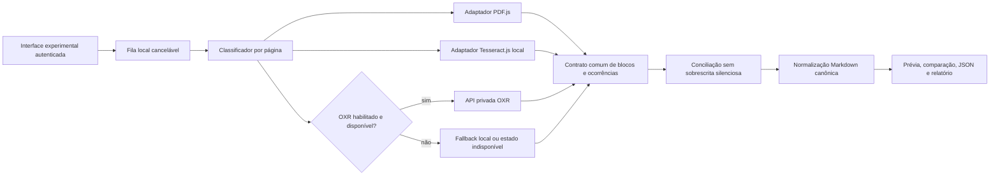

# PDF Intelligence Engine — auditoria e arquitetura proposta

## Contexto e escopo

Este documento registra a auditoria inicial da ferramenta interna de PDF para Markdown no repositório `website-tjba-ios1vcrime-2026` e define uma arquitetura candidata para uma versão experimental paralela. O escopo preserva a página atual e não autoriza, por si só, ativação de serviços remotos, substituição em produção, merge ou publicação.

O checkout inspecionado é `main`, commit `1eb2ad4c32601c6e2dbbe4571d4142c0783d307b`, com versão local `V. 1.88.0056`. A consulta somente leitura ao GitHub confirmou que `origin/main` aponta para o mesmo SHA. Isso identifica a versão do repositório, não a cópia efetivamente implantada: o SHA publicado e o resultado do último deploy não foram confirmados. Há dois arquivos não rastreados preexistentes (`.github/workflows/rei66-cpf-concurrency.yml` e `tests/api-security/run-cpf-concurrency-isolated.ps1`), mantidos intactos. A consulta ao VPS não retornou evidência utilizável nesta sessão.

As regras consideradas incluem o canônico global, o canônico Markdown, o canônico técnico e o canônico de segurança. A decisão de produto recuperada no Notion exige preservar o original, marcar página e cobertura, conferir visualmente dados críticos e não inferir trechos ilegíveis. A página dessa decisão é privada e não deve receber documentos processuais nem exemplos com dados reais.

## Fluxo atual confirmado

`app/views/internal/skills-pdf-markdown.php` protege a página com `Security::requireAuthentication()` e carrega PDF.js 3.11.174 e JSZip 3.10.1 de CDN. `public/frame.php` associa a página à rota interna `skillspdfmarkdown`. A interface aceita vários arquivos PDF e informa limite individual de 20 MB.

`public/assets/js/modules/skills/pdf-markdown.js` converte cada arquivo em sequência, usa `pdfjsLib.getDocument`, extrai `getTextContent()` página a página, tenta recompor linhas por coordenadas verticais, sinaliza páginas sem texto, gera um Markdown básico com títulos de página, oferece cancelamento e downloads individuais/ZIP. O PDF permanece no navegador conforme o aviso da interface; não foi observado upload no fluxo inspecionado.

`public/assets/js/modules/skills/pdf-split.js` e `app/views/internal/skills-pdf-split.php` formam uma ferramenta de divisão independente, reutilizável como referência de interação e ZIP, mas não executam OCR. Na linha de base antes desta tarefa não havia adaptadores, workers, modelos, corpus de benchmark ou serviços de OCR no código pesquisado. PDF.js não classifica páginas, não reconstrói tabelas/colunas explicitamente e não fornece estimativa de confiança na ferramenta original.

Após a auditoria, foram adicionados um contrato comum e adaptadores experimentais em `public/assets/js/modules/skills/pdf-intelligence-core.js`, `pdf-intelligence-pdfjs.js` e `pdf-intelligence-tesseract.js`. O OCR rasteriza páginas com PDF.js e usa assets locais Tesseract.js 7.0.0, core LSTM WASM 7.0.0 e dados `por` integerizados `@tesseract.js-data/por` 1.0.0. O core WASM portátil foi selecionado para não depender de SIMD/GPU; isso reduz compatibilidade de desempenho e precisa de benchmark. Os assets licenciados e os hashes dos pacotes estão inventariados em `public/assets/ocr/tesseract/LICENSES.md`; há revisão de notices/licença ainda pendente.

Uma página paralela autenticada foi registrada em `skillspdfintelligence`, mantendo a ferramenta original em `skillspdfmarkdown`. A interface experimental oferece modos rápido, OCR local e híbrido; OXR aparece desabilitado porque nenhuma instância privada ou configuração segura foi confirmada. A UI inclui seleção múltipla, cancelamento, progresso, prévia comparativa, downloads Markdown/JSON e ZIP. O adaptador OCR e seus assets locais estão implementados, mas ainda não foram medidos contra imagens ou PDFs de referência. O smoke real com texto sintético foi bloqueado porque o ambiente não permitiu abrir um listener HTTP local; testes unitários com worker simulado validam apenas o contrato e o mapeamento da resposta.

## Ambiente e dependências observadas

O ambiente local reporta Windows x64, 16 processadores lógicos, 31,7 GiB de memória total e 6,9 GiB livres no momento da consulta, com aproximadamente 1,77 TiB livres no volume D:. A leitura CIM de modelo de CPU/GPU/VRAM foi negada pelo ambiente; portanto, fabricante, memória da GPU e capacidades de execução não estão confirmados.

Não há executáveis `tesseract` ou `pdftotext` disponíveis no PATH consultado, nem módulos Python `pytesseract`, `paddleocr`, `paddle`, `torch` ou `transformers`. O projeto não lista Tesseract.js, PaddleOCR ou OXR em `package.json`/`composer.json`. Isso não prova ausência em outros diretórios ou no ambiente remoto.

O ambiente remoto permanece não auditado quanto a CPU, RAM, GPU, VRAM, armazenamento e runtime. A arquitetura não deve presumir que o host web aceite workloads OCR ou modelos grandes. A indisponibilidade de evidência impede qualquer afirmação de benchmark, capacidade operacional ou adequação do OXR na produção.

## Avaliação dos motores e licenças

PDF.js já é o extrator de texto nativo usado pelo fluxo atual; a licença e o artefato carregado devem ser registrados na futura revisão de dependências, inclusive porque os arquivos vêm de CDN. O Tesseract.js oferece OCR JavaScript com execução em browser, mas exige worker e dados de idioma. Para confidencialidade, esses artefatos devem ser servidos localmente e documentos/imagens não podem ser enviados a endpoints públicos.

PaddleOCR é uma opção técnica possível, mas a família inclui caminhos de inferência distintos e dependências de runtime específicas. A documentação oficial consultada descreve PaddlePaddle 3.x ou Transformers como mecanismos e inclui suporte a CPU e GPU. O projeto principal informa licença Apache 2.0; licença e origem dos pesos/modelos selecionados precisam ser conferidas separadamente antes de redistribuição ou produção.

OXR fornece parsing documental por API/CLI/SDK e oferece implantação privada. A FAQ oficial recomenda começar com 24 GB de VRAM e registra relatos comunitários em 12–16 GB; também admite CPU com desempenho reduzido e execução offline depois da instalação. O modelo listado no Hugging Face ocupa aproximadamente 3,07 GB de pesos, sem incluir runtime, cache, memória de execução ou outros serviços. A licença é Apache 2.0 com condições adicionais: limite de financiamento/receita agregados acima de USD 2 milhões exige licença comercial escrita; fornecer produto/serviço a terceiros abaixo do limite exige atribuição visível “Powered by SoMark OXR”. A aplicabilidade desses termos ao produto institucional precisa de revisão jurídica antes da exposição a usuários.

Referências externas consultadas em 27/11/2026:

- [Repositório e README oficial do OXR](https://github.com/SoMarkAI/OXR)
- [FAQ oficial do OXR](https://github.com/SoMarkAI/OXR/blob/main/docs/FAQ.md)
- [Licença oficial do OXR](https://github.com/SoMarkAI/OXR/blob/main/LICENSE)
- [Modelo OXR-1.0 no Hugging Face](https://huggingface.co/SoMarkAI/OXR-1.0)
- [Tesseract.js](https://github.com/naptha/tesseract.js)
- [PaddleOCR](https://github.com/PaddlePaddle/PaddleOCR)
- [PDF.js](https://github.com/mozilla/pdf.js)

## Arquitetura candidata

A arquitetura proposta separa leitura, roteamento, motores, normalização e apresentação. Os componentes do diagrama abaixo são candidatos, não código atualmente existente. O modo rápido usa PDF.js; OCR usa Tesseract.js local; o modo híbrido seleciona por página; OXR só pode ser usado por adaptador para instância privada com feature flag explicitamente habilitada e health check aprovado.

O contrato comum deverá conter documento e hash local, página original, índice/ordem do bloco, tipo, texto, coordenadas normalizadas opcionais, motor e versão, confiança opcional, duração e ocorrências. O contrato deve distinguir “sem texto”, “baixa confiança”, “ilegível” e “falha do motor”; confiança ausente não pode virar nota artificial. Arquivos e conteúdo extraído não devem entrar em logs técnicos.

A classificação inicial deve ser determinística e explicável: comparar quantidade/estrutura de texto extraído por página com limiares validados no corpus; páginas vazias ou insuficientes podem ser encaminhadas ao OCR. Divergências em número processual, nomes, datas e valores viram ocorrências visíveis para revisão. O pipeline não completa texto e não promove automaticamente uma saída de OCR sobre conteúdo conflitante.

O modo OXR exige um backend/proxy privado se o endpoint não puder ser alcançado com segurança pela rede local do browser. Esse backend precisa de autenticação por operação, limite de tamanho/página/tempo, fila com cancelamento, diretório temporário isolado, remoção segura, segredo fora do repositório e logs sem payload. Não há endpoint OXR privado nem configuração confirmados; a integração fica desabilitada até a infraestrutura e a revisão de segurança serem demonstradas.

## Métricas de referência e plano de benchmark

Nenhuma métrica de qualidade ou desempenho foi medida nesta auditoria. Não existe corpus de referência identificado no repositório pesquisado, e não foram enviados PDFs para este trabalho. Assim, CER, WER, fidelidade de campos críticos, integridade estrutural, reconstrução de tabelas, latência, RAM/VRAM e taxa de falhas permanecem sem baseline; não se deve declarar melhora nem homologação.

O benchmark deve usar documentos fictícios ou devidamente anonimizados e gabaritos revisados por pessoa. A matriz inclui PDFs nativos, digitalizados, híbridos, girados, baixa resolução, tabelas, colunas, carimbos/assinaturas, documentos jurídicos fictícios em pt-BR, arquivos extensos e corrompidos. Comparações só devem incluir motores cuja execução local/privada foi confirmada e a licença do artefato e dos pesos foi registrada.

Cada execução deve salvar apenas fixture sintética, configuração/versionamento do motor e métricas agregadas. O relatório precisa mostrar cobertura por página, CER/WER, campos críticos por categoria, estrutura, tabelas, tempo, pico de memória e falhas, com limitações e ambiente. Uma média geral não pode ocultar divergência em campo crítico.

## Critérios de entrada para desenvolvimento e homologação

O desenvolvimento seguro começou em paralelo à auditoria: contrato, adaptadores locais, assets fixados e tela experimental existem no checkout. A branch remota `origin/main` foi confirmada no mesmo SHA do checkout, mas o SHA implantado e a capacidade da infraestrutura de produção continuam sem evidência. Antes de qualquer publicação, é necessário validar o tamanho do bundle estático e os tipos MIME servidos no host, identificar a versão implantada e concluir a revisão de licenças/notices.

Antes de habilitar processamento remoto, é necessário comprovar isolamento de arquivos, limites, autenticação/autorização, cancelamento, limpeza de temporários, ausência de conteúdo nos logs e ausência de tráfego para provedores externos. A revisão deve abranger arquivo malicioso, PDF corrompido, flood de páginas, timeout e falha do serviço privado. OCR no browser deve degradar para erro visível quando os assets locais estiverem indisponíveis.

Homologação requer fixtures de referência, testes unitários e de integração dos adaptadores, E2E da interface paralela, regressão da ferramenta antiga, validação automatizada do Markdown e do JSON, revisão de segurança e benchmarks reproducíveis. Foram executados testes unitários de contrato e adaptadores simulados e teste estático da política de acesso; a verificação de sintaxe PHP/JavaScript e `git diff --check` passaram. O smoke OCR real no navegador, integração ponta a ponta e benchmark permanecem pendentes.

## Situação das etapas

| Etapa | Estado | Evidência ou dependência |
|---|---|---|
| Planejamento | Parcial | Critérios e gates documentados; acompanhamento criado em [REI-352](https://linear.app/reis-developer/issue/REI-352/webapp-2026-evoluir-pdf-para-markdown-com-extracao-hibrida). |
| Auditoria do repositório | Parcial | Fluxo local e dependências inspecionados; `origin/main` corresponde ao SHA local; implantação e infraestrutura remota não confirmadas. |
| Benchmark | Pendente | Falta corpus fictício/anonimizado, pesos e ambiente reproduzível. |
| Desenvolvimento | Parcial | Contrato, adaptadores PDF.js/Tesseract.js locais, assets OCR e página paralela existem; PaddleOCR/OXR seguem sem adaptador operacional. |
| Testes e correções | Parcial | Sintaxe JS/PHP, 9 testes Node do contrato/adaptadores simulados, teste de acesso e diff-check passaram; OCR real foi bloqueado pelo listener local, integração visual e desempenho pendentes. |
| Homologação | Pendente | Requer gates de segurança, qualidade, desempenho e aprovação formal. |

## Considerações finais

A evidência atual sustenta a existência local de adaptadores PDF.js e Tesseract.js, mas ainda não confirma o reconhecimento real no navegador nem fidelidade a documentos. A modalidade básica foi projetada sem GPU. A evidência não sustenta habilitar PaddleOCR ou OXR na infraestrutura do projeto. OXR deve continuar desabilitado até haver instância privada, capacidade confirmada, dependências verificadas e decisão jurídica sobre licença e atribuição.

A ferramenta atual permanece intacta. Próximos passos: executar o smoke OCR real em ambiente que permita servir os assets locais; definir corpus artificial com gabaritos; revisar licenças; fechar auditoria da implantação e da infraestrutura; implementar adaptadores PaddleOCR e OXR privado somente após seus gates. Nenhuma homologação, publicação, merge ou substituição foi realizada.
